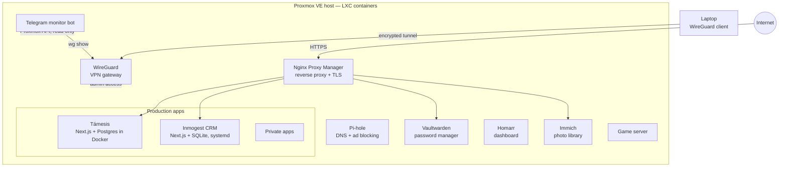

# Homelab — Proxmox VE

A single-node Proxmox VE server that I run and maintain. It hosts my self-hosted services and the production deployments of my own web applications, each isolated in its own LXC container, with remote access through WireGuard only.

## Architecture

| Service | Role |
|---|---|
| **WireGuard** | Only way to reach the management plane from outside |
| **Nginx Proxy Manager** | Reverse proxy and TLS termination for the public apps |
| **Pi-hole** | Network DNS and ad blocking |
| **Vaultwarden** | Self-hosted Bitwarden-compatible password manager |
| **Homarr** | Service dashboard |
| **Immich** | Self-hosted photo and video backup |
| **Telegram monitor bot** | Metrics on demand, alerts when a service or container goes down — [code](telegram-monitor-bot/) |
| **[Támesis](https://github.com/GabrielHuertasdl/tamesis)** | Agency site + multi-tenant SaaS; Docker Compose, versioned deploys with automatic `pg_dump` before migrations and one-command rollback |
| **[Inmogest CRM](https://github.com/GabrielHuertasdl/inmogest-crm)** | Built locally, shipped with rsync, run as a dedicated system user under systemd |

## Practices

- **One service per LXC container**: isolation, independent snapshots and restarts, small attack surface.
- **No exposed management**: Proxmox UI and SSH are reachable only through the VPN.
- **Least privilege for automation**: the monitoring bot uses a read-only API token and a dedicated SSH key, never the root password.
- **Hardened systemd units** (`NoNewPrivileges`, `ProtectSystem=strict`, `PrivateTmp`).
- **Secrets outside the code**: environment files with `chmod 600`, never committed.
- **Safe deploys**: database backup before every migration, versioned images, rollback to any tag.

## Notes

- [WireGuard: reaching a remote LAN that overlaps your local subnet](docs/wireguard-subnet-overlap.md)
