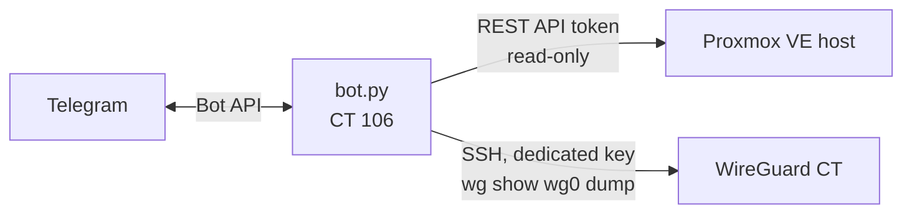

# Telegram Monitor Bot — Proxmox + WireGuard


A Telegram bot that watches a Proxmox VE host and a WireGuard tunnel. It answers on demand with host metrics and **only speaks unprompted when something goes down** — no recovery spam, no noise.

## Features

- **On-demand panels** via an inline keyboard (Estado / Disco / VPN / Servicios) or text commands: CPU, RAM, cores, load, uptime, storage usage, guest list.
- **Edge-triggered alerts**: polls every 60 s and notifies only when a watched VM/CT or host service transitions to stopped.
- **WireGuard peers**: endpoint, allowed IPs, last handshake, online/offline, traffic.
- **Allow-list**: the bot ignores every chat id not in `CHAT_ID`.

## How it reads data



- **No root SSH into the hypervisor.** Host metrics come from the Proxmox REST API using an API token.
- **WireGuard** is read over SSH with a key that exists only for this bot and runs a single read command.
- **systemd hardening**: `NoNewPrivileges`, `ProtectSystem=strict`, `ProtectHome`, `PrivateTmp`; the only writable path is the bot directory.

## Setup

1. **Proxmox API token** — Datacenter → Permissions → API Tokens → Add. Keep *Privilege Separation* **on** and grant the token the `PVEAuditor` role on `/` (read-only).
2. **WireGuard access** — generate a key for the bot (`ssh-keygen -t ed25519 -f /opt/telegrambot/botmon_ed25519`) and authorise its `.pub` on the WireGuard host.
3. **Install**

   ```bash
   git clone https://github.com/GabrielHuertasdl/homelab.git
   cp -r homelab/telegram-monitor-bot /opt/telegrambot && cd /opt/telegrambot
   python3 -m venv venv && venv/bin/pip install -r requirements.txt
   cp .env.example .env && chmod 600 .env   # fill BOT_TOKEN, CHAT_ID, Proxmox token, WG host
   cp telegrambot.service /etc/systemd/system/
   systemctl daemon-reload && systemctl enable --now telegrambot
   ```

## Files

| File | Purpose |
|---|---|
| `bot.py` | Telegram handlers, panels, polling job and down-detection |
| `proxmox.py` | Proxmox REST client and WireGuard peer reader |
| `config.py` | Reads all settings from environment variables |
| `.env.example` | Template for secrets and host settings |
| `telegrambot.service` | Hardened systemd unit |
